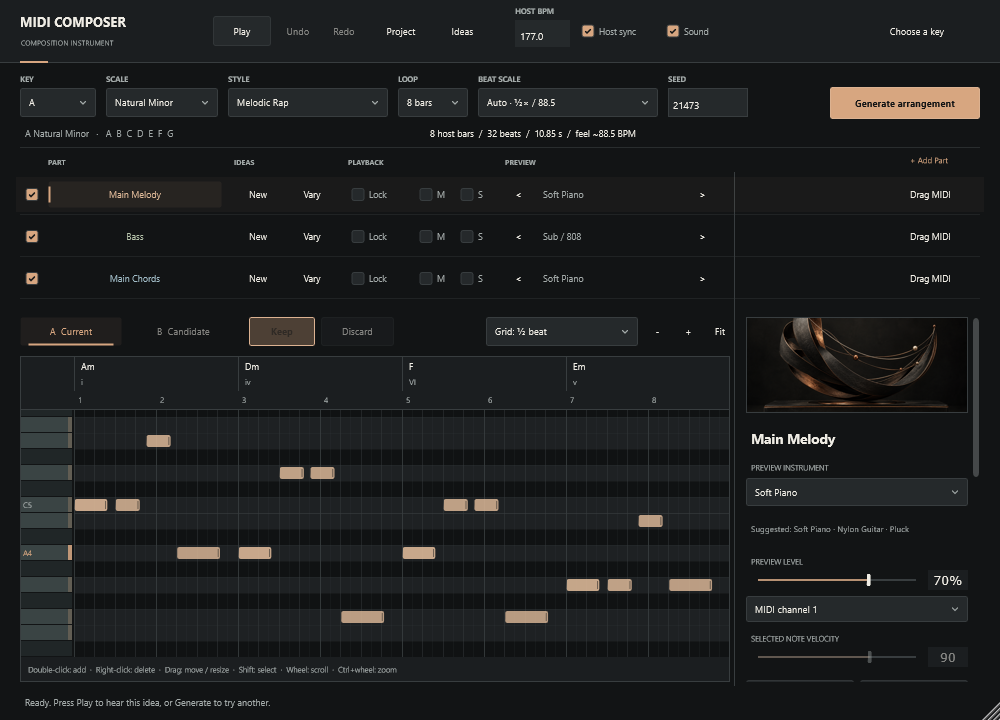

# MIDI Composer VST3

An offline MIDI composition instrument for Windows and FL Studio, with connected melody, bass and chords, recoverable candidates, part locks and an editable piano roll.

## Download

**[Download Windows VST3 installer](https://github.com/Terpytoine/midi-composer-downloads/releases/download/v0.1.0-dev/MIDIComposer-VST3-Setup-0.1.0-dev-Windows.exe)**

This is a **development prerelease** for Windows 10/11 x64. The EXE installs the VST3; it is not a standalone music app. The installer and plugin are unsigned.

1. Close FL Studio and run the downloaded installer. Approve the normal Windows administrator prompt and follow the short wizard.
2. In FL Studio, open **Options → Manage plugins** and choose **Find installed plugins**.
3. Load **MIDI Composer Dev** as an instrument, then press Play or Generate. Compare A/B and use Keep or Discard before trying another candidate.

The installer uses the standard Common Files VST3 folder and leaves FL Studio's saved search settings unchanged. [Installation details](INSTALLER.md) and [actual verification results](TESTING.md) explain the remaining host checks. A raw VST3 ZIP is available in the same release for manual installation. Check release files against `SHA256SUMS.txt`.

## Timing that stays inside your loop

At **180 BPM**, choose **1×** for a 180 BPM feel or **½×** for a 90 BPM feel. Both remain **eight host bars / 32 beats / 10.67 seconds**. Auto suggests a beat scale from the host tempo, and manual choices override it. The separate **Grid: ½ beat** control sets editing snap.

Melody, bass and main chords start enabled. Optional countermelody and chord layer are behind Add Part. New ideas are candidates, so your current idea remains recoverable; lock parts to preserve their pitches, starts, lengths and velocities. MIDI is editable musical data, while the receiving instrument supplies the sound.

New Idea checks recent pitch/onset patterns and makes bounded retries to avoid recent repeats. Discarded candidates are remembered within the project, and recent-pattern history survives save/restore. Fresh instances use new seeds; an explicit seed can replay an idea. Variety is best effort, with no guarantee that similar phrases have never existed elsewhere.

## What is public

This repository contains official binary downloads, instructions, notices and test reports. The source is maintained privately. You can tweak plugin settings and generated MIDI and save your own projects; public downloads do not grant permission to change the official source or publish official updates. Copies of distributed software can still be modified, and no security guarantee is implied.

The engine uses deterministic procedural generation, not an AI model. Preview instruments are original synthesized approximations. [Third-party notices and sound origins](THIRD_PARTY.md) are included with the download and installer.

## Validation scope

Generation, processor/state and UI checks, independent VST3 lifecycle validation and installer payload verification are reported in [TESTING.md](TESTING.md), [BUILD_VALIDATION.md](BUILD_VALIDATION.md), [UI_VALIDATION.md](UI_VALIDATION.md) and [INSTALLER_VALIDATION.md](INSTALLER_VALIDATION.md). An installer integrity check does not establish successful installation or FL Studio routing. Actual Windows install/uninstall transactions and FL Studio loading, drag-and-drop, multitrack import and live routing remain separate host tests.

The working label is temporary. This prerelease has no final brand or claim of production readiness.
